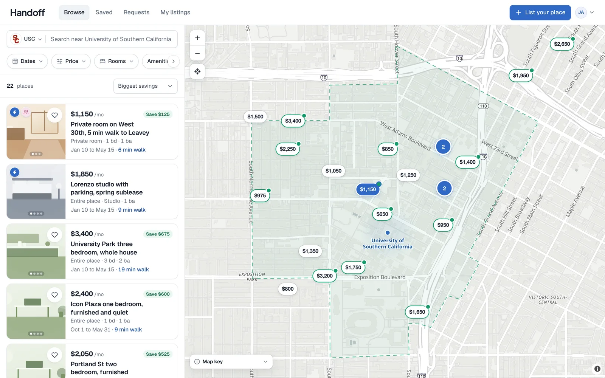
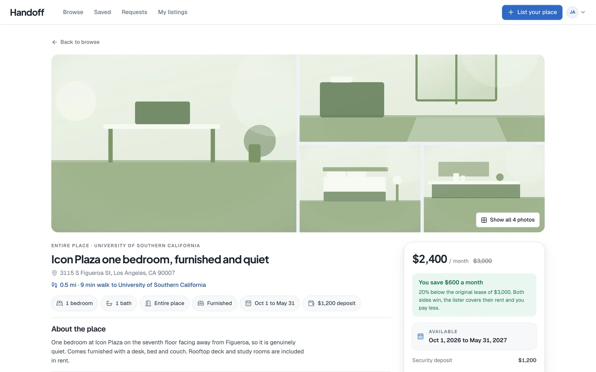
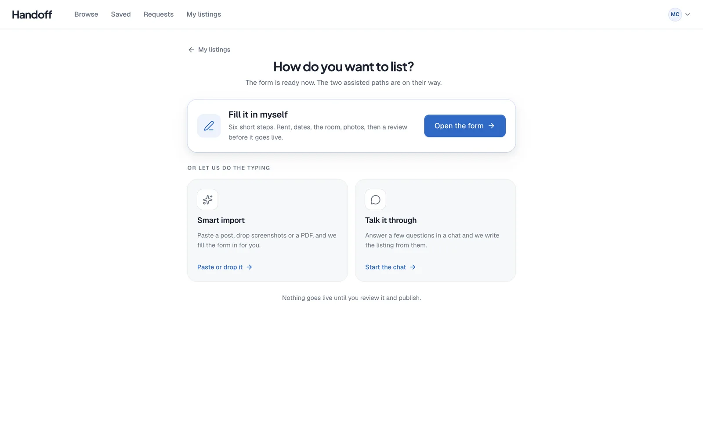
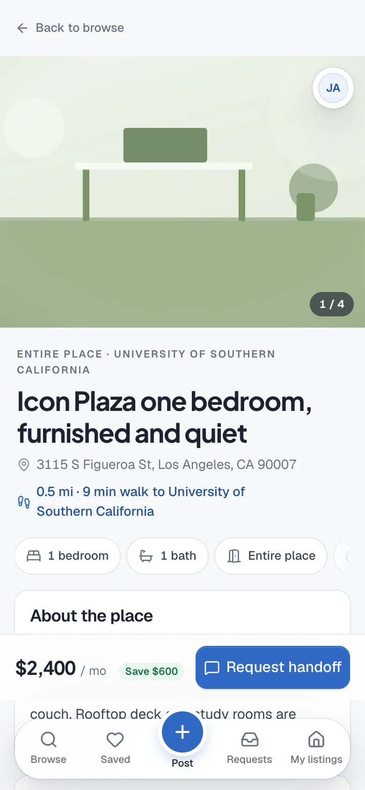
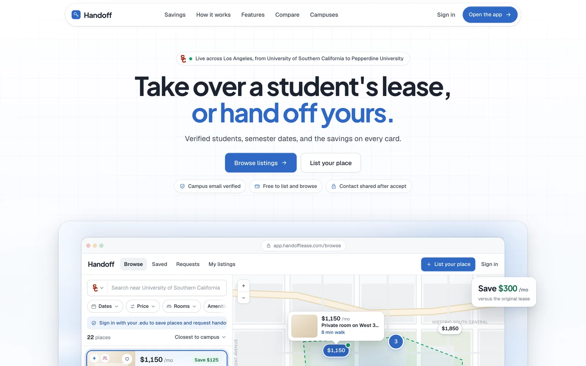

# Handoff

A sublease marketplace for college students that shows how much you save on every listing. Live at **[handofflease.com](https://handofflease.com)**, the app at **[app.handofflease.com](https://app.handofflease.com)**.

I co-founded Handoff in my technology entrepreneurship class at USC. Before building anything we surveyed 47 students across four Los Angeles campuses. 81% struggled to find someone to take over their lease, and most ended up on Facebook or Craigslist, where you can't tell a real student from a scam. That set the two rules the product is built on.

1. **Every listing comes from a verified student.** Accounts are tied to a campus email.
2. **Every listing shows the savings.** Listers can enter what they pay on the original lease, so each card, pin and listing page shows how much a taker saves each month, and "Biggest savings" sorts to the top.



## What it does

- **Browse on a map.** A full screen split of listings and a map, with filters for dates, budget, room type, roommate preference and amenities. Price pins slide into clusters as you zoom, hovering a card lights up its pin, and a USC public safety patrol zone overlay helps students judge a neighborhood. Every campus in the Los Angeles area is live, 22 in all.
- **List in a minute.** Listing starts with a choice instead of a form. Paste a post or drop screenshots or a PDF and **Smart import** turns it into a draft, talk it through in a short chat, or fill in a six step form. The AI paths only ever produce a draft, and every field they could not fill is flagged for the student to add.
- **Hand off safely.** Takers send a request, the lister accepts or declines, and contact details are only revealed to the two students in an accepted request. Each student chooses which channels to share (phone, Instagram, Facebook, with email always shared because it's the verified identity). Signed out visitors see photos, price, savings and dates, but the address, description, lister and exact pin stay locked.
- **Roommate preferences done carefully.** For a private or shared room, a lister can ask for women or men preferred or only, which fair housing rules allow for shared homes, and never for an entire place. A student's own gender is optional and private.
- **Boost.** The one paid product. $9 puts one listing at the top of every sort for seven days, with a filled pin on the map, a Boosted tag and a small stats panel for the lister. Payments aren't connected yet, so it runs as a free launch boost while the ranking and stats get real use.
- **Phone first.** On phones browse is a full map with a card carousel and a Map or List toggle, and every screen follows iOS conventions.

| Listing page | Starting a listing | On a phone |
|---|---|---|
|  |  |  |

## Decisions worth explaining

- **Listing and browsing are free forever, and Handoff never takes a cut of rent.** Revenue comes from listers who want attention on a listing for a short window, which is exactly when a sublease is urgent. A typical room near USC lists around $1,200 a month, so one empty week costs a lister about $280, and a $9 boost costs less than one empty day.
- **AI listing help is free too.** The point is to remove the blank form, the moment most listers give up. A real text import measured about 1,000 input and 440 output tokens, well under a cent, and every call is logged so cost stays visible. Per account limits cap abuse.
- **Verification only where it matters.** Signup is three quick steps and the account works right away. Verifying a campus email (six digit code or link) is required only to publish a listing or send a request.
- **No sample data in production.** The demo seed refuses to run against production paths, and the integration tests run in an isolated temporary directory with a mail capture transport.



## How it's built

```
handofflease.com         static homepage (marketing/), framed around the real app
app.handofflease.com     React + TypeScript (Vite) front end
        │
        ▼
Express API (server/) ── SQLite (better-sqlite3), photos on disk, sharp for resizing
        │                  campus email verification and password reset over SMTP
        │                  Smart import through the OpenAI Responses API with a strict JSON schema
        ▼
internal.handofflease.com  the same process and build, an admin dashboard on its own host
```

- **Front end.** React 19, React Router, plain CSS under `src/styles/` with design tokens and motion tokens, MapLibre GL on the keyless OpenFreeMap style.
- **API.** Express 5 with zod validation, documented in [API.md](API.md). Sessions are same origin cookies. Verification and reset links expire and are single use.
- **Admin dashboard.** Totals and 30 day charts, every account, listing, request and report, AI token usage, an audit log of admin actions, and a system page with the release, schema, host load and backups. Access needs both an admin flag set on the server and an email on an allowlist, and the admin API answers 404 on the public host. Wide tables keep each trackpad swipe on one axis, and on a phone they scroll sideways only while the page scrolls the rows.
- **Read only MCP.** `POST /mcp` on the internal host answers one tool, `sightpane_overview`, with counts (students, live listings, pending requests, open reports) and the newest public listing titles, never a student's details. It needs a Bearer token made on the server, details in [server/README.md](server/README.md).
- **Operations.** Each deploy is a new release folder switched in by a symlink, with a verified data backup taken just before the switch and an automatic rollback if a health check fails. Daily backups of the database and photos run on a timer. Details in [docs/operations.md](docs/operations.md).
- **Tests.** Real HTTP integration tests cover two student request flows, contact privacy, verification, reset token replay and concurrency. `npm test` runs them.

## Run it locally

```bash
npm ci
cp .env.example .env          # set HANDOFF_ORIGIN=http://127.0.0.1:4741 and HANDOFF_DATA_DIR=./data
npm run server                # the API on :4742
npm run dev                   # the app on :4741
HANDOFF_DATA_DIR=./data npm run seed:demo   # optional, demo students and listings around USC, UCLA and LMU
```

Verification email needs SMTP settings, and Smart import needs an `OPENAI_API_KEY`. Without them those features say they're being set up and everything else works. `npm run build` then `npm start` serves the API and the built app together.

## Project structure

```
src/            the app: pages, components, map, styles
server/         the API, auth, listings, requests, boosts, AI import, admin
marketing/      the homepage
scripts/        demo seed, admin grant, operator imports, SMTP smoke test
deploy/         systemd units, Caddy snippets, the backup job
tests/          integration tests
docs/           operations, release checks, the patrol zone data
```

## Team

Co-founded by David Nguyen as part of USC's technology entrepreneurship course, then rebuilt three times, from a Lovable prototype to a Next.js version to this React and Express app on our own server. Reach me at [daviddn@usc.edu](mailto:daviddn@usc.edu) or see more of my work at [daviddn.dev](https://daviddn.dev).
